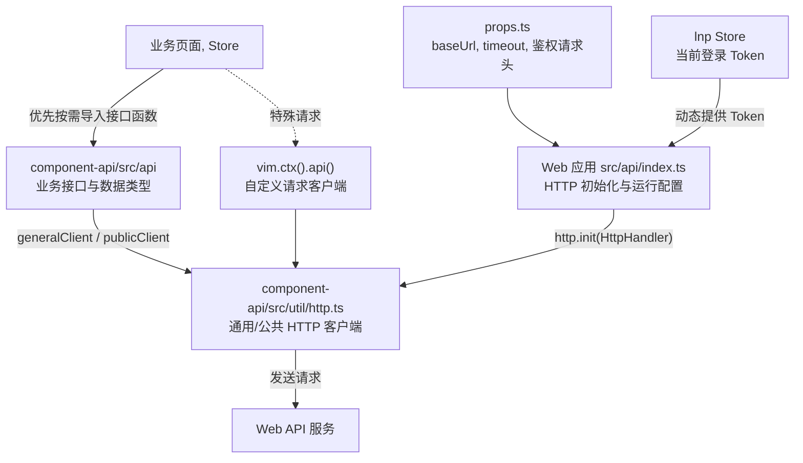

# Familyhelper UI View - API 接口请求模块

本文说明 `familyhelper-ui-view` 中 API 请求模块的职责、使用方式、配置位置与修改边界，
覆盖 `webapp-pc`、`webapp-mobile` 的 `src/api` 模块，以及二者与 `component-api` 工作区包的协作关系。

API 请求能力分为两层：Web 应用侧负责把当前运行环境、超时时间和登录 Token 提供给 HTTP 客户端，
`component-api` 负责声明业务数据类型、封装后端接口路径并发起具体请求。
业务页面通常只需要调用 `component-api` 已有的接口函数，不应自行重复拼接相同的后端请求。

## 适用范围

本文适用于以下源码：

- `packages/webapp-pc/src/api`：PC 端 API 模块。
- `packages/webapp-mobile/src/api`：移动端 API 模块。
- `packages/component-api/src/api`：按后端模块组织的接口函数和业务类型。
- `packages/component-api/src/util`：HTTP 客户端、分页参数与通用响应类型。
- PC、移动端的 `src/util/response.ts` 与 `src/util/lookup.ts`：应用侧响应解析和分页辅助方法。

本文不逐一列举所有业务接口，也不说明 Web API 服务的部署过程。
Web API 地址如何部署、代理或暴露，应结合实际环境和部署文档确定；本文只说明前端从哪里读取并使用该地址。

## 模块职责

三个模块之间的调用关系可以概括为：



各层职责如下：

| 层级                             | 主要职责                                                                   | 不应承担的职责                                   |
|----------------------------------|----------------------------------------------------------------------------|--------------------------------------------------|
| `webapp-*/src/api`               | 选择环境地址、组合基础 URL、初始化 HTTP、接入登录 Token、向 VIM 暴露客户端 | 重复实现各业务模块的接口函数                     |
| `component-api/src/api`          | 声明请求参数、实体、键和响应类型，封装具体业务接口                         | 依赖 PC 或移动端页面、Store 和组件库             |
| `component-api/src/util/http.ts` | 基于 Axios 实现通用/公共客户端、统一 URL 和请求参数处理                    | 决定当前应用的服务地址和 Token 来源              |
| 页面与 Store                     | 调用接口、解析业务响应、更新界面或状态                                     | 直接初始化全局 HTTP，或到处散落相同的 URL 字符串 |

PC 端与移动端当前使用相同的 API 模块结构和默认配置，但它们是两个独立应用。
修改其中一个应用的 `src/api/props.ts` 不会自动同步到另一个应用；需要保持一致时，应同时检查并修改两处。

## 目录结构

### Web 应用侧

PC 与移动端的 `src/api` 目录结构相同：

```text
src/api/
├── index.ts   - API 模块入口、生命周期与 HTTP 初始化
├── props.ts   - 环境地址、路径前缀、超时和鉴权请求头配置
├── types.ts   - VimApi 与 ApiSetting 类型
└── README.md  - 模块内简要说明
```

`index.ts` 在 VIM 初始化阶段执行以下工作：

1. 根据 `import.meta.env.MODE` 选择 `development`、`debug` 或 `production` 地址前缀。
2. 依次追加 `apiPrefix` 与 `versionPrefix`，得到缓存的基础 URL。
3. 调用 `component-api` 的 `http.init(...)`，提供基础 URL、超时时间、鉴权请求头名称和 Token 获取函数。
4. 将模块状态切换为 `initialized`，此后才允许取得 `baseUrl`、`generalClient` 和 `publicClient`。

### component-api

`component-api` 的主要结构如下：

```text
packages/component-api/
└── src/
    ├── api/
    │   ├── 各业务模块接口...
    │   ├── acckeeper/
    │   ├── audit/
    │   ├── fileio/
    │   ├── logicengine/
    │   ├── notify/
    │   ├── rbac/
    │   ├── settingrepo/
    │   ├── subgrade/
    │   └── system/
    └── util/
        ├── http.ts       - HTTP 客户端及其初始化协议
        ├── request.ts    - PagingInfo 等通用请求类型
        └── response.ts   - ResponseData、PagedData、Pres、Prespa 等响应类型
```

`src/api` 下的一级目录对应后端模块。
目录内文件通常对应一种实体、指示器、操作或支撑接口，例如 `rbac/role.ts`、`system/login.ts`。
该包没有要求业务方先从统一入口注册接口；Web 应用按实际需要直接导入对应源码文件的类型和函数。

## 请求初始化与客户端差异

### 基础 URL

当前 `props.ts` 提供以下配置项：

| 配置项                           | 当前默认值                                                    | 说明                              |
|----------------------------------|---------------------------------------------------------------|-----------------------------------|
| `developmentUrlPrefix`           | `http://localhost:8080/familyhelper_webapi_node_war_exploded` | development 模式的服务地址前缀    |
| `debugUrlPrefix`                 | `http://localhost:8080/familyhelper_webapi_node_war_exploded` | debug 模式的服务地址前缀          |
| `productionUrlPrefix`            | `/familyhelper-webapi`                                        | production 模式的服务地址前缀     |
| `apiPrefix`                      | `/api`                                                        | API 公共路径前缀                  |
| `versionPrefix`                  | `/v1`                                                         | API 版本路径前缀                  |
| `timeout`                        | `600000`                                                      | 请求超时时间，单位为毫秒          |
| `authenticationRequestHeaderKey` | `Authentication`                                              | 通用客户端写入 Token 的请求头名称 |

按当前默认配置，development 和 debug 模式组合后的基础 URL 为：

```text
http://localhost:8080/familyhelper_webapi_node_war_exploded/api/v1
```

production 模式组合后的基础 URL 为：

```text
/familyhelper-webapi/api/v1
```

接口函数还会在基础 URL 后追加 `/<module>/<url>`。
例如 `system/login.ts` 中的登录请求最终会访问基础 URL 下的 `/system/login`。

`src/api/index.ts` 只接受 `development`、`debug`、`production` 三种模式；使用其它 Vite mode 时会抛出“未知的环境”错误。
另外，`scripts-config.json` 中的 `server.host`、`server.port` 等字段配置的是前端开发服务器，不是 Web API 服务地址。

### 通用客户端与公共客户端

API 模块提供两个 `HttpClient`：

- `generalClient()`：用于需要登录认证的接口。每次请求都会读取 `lnp` Store 中的当前 Token，
  并写入 `authenticationRequestHeaderKey` 指定的请求头。
- `publicClient()`：用于登录、服务器时间、公开配置等无需登录认证的接口，不写入认证请求头。

两种客户端都支持 `get`、`post`、`patch` 和 `del`，并按以下规则处理参数：

- GET、DELETE 的参数放入查询参数。
- POST、PATCH 的参数作为请求体发送。
- GET、DELETE 的响应类型支持 `json` 和 `blob`。
- POST、PATCH 的内容类型支持 JSON 与 `multipart/form-data`。
- 客户端返回 Axios 响应中的 `data`；业务响应的 `meta.code` 仍由应用侧解析。

业务接口应根据后端是否要求认证选择客户端，而不是根据页面是否处于登录页进行选择。
例如登录操作使用公共客户端，退出当前账号和登录延期使用通用客户端。

## 使用说明

### 使用自带的请求

优先从 `component-api/src/api` 按需导入接口类型与函数。
以下示例读取所有角色，并复用应用侧的分页辅助方法：

```typescript
import {
  all as allRole,
  type Role,
} from '@dwarfeng/familyhelper-ui-component-api/src/api/rbac/role.ts'

import { lookupAllToList } from '@/util/lookup.ts'

async function getAllRoles(): Promise<Role[]> {
  return await lookupAllToList((pagingInfo) => allRole(pagingInfo))
}
```

普通非分页响应通常通过 `resolveResponse` 解析：

```typescript
import {
  get as getRole,
  type Role,
} from '@dwarfeng/familyhelper-ui-component-api/src/api/rbac/role.ts'
import { type StringIdKey } from '@dwarfeng/familyhelper-ui-component-api/src/api/subgrade/key.ts'

import { resolveResponse } from '@/util/response.ts'

async function getRoleByKey(key: StringIdKey): Promise<Role> {
  return await resolveResponse(getRole(key))
}
```

`component-api` 中的常用响应类型为：

- `ResponseData<E>`：包含 `data` 与 `meta` 的业务响应。
- `PagedData<E>`：包含页码、总页数、数量和数据列表的分页数据。
- `Pres<E>`：`Promise<ResponseData<E>>` 的简写。
- `Prespa<E>`：`Promise<ResponseData<PagedData<E>>>` 的简写。

应用侧 `resolveResponse(...)` 会在 `meta.code === 0` 时返回 `data`；
业务失败或网络错误会交给默认或调用方指定的处理器，并通过当前 Visualizer 显示相应通知。
因此，在页面与 Store 中应优先复用它，不要在每个调用点重复编写一套 `meta.code` 判断。

### 使用自定义的请求

只有在 `component-api` 尚未提供相应接口、且该请求确实不适合先沉淀为共享接口时，才直接取得客户端发起自定义请求。

```typescript
import vim from '@/vim'

import { type Pres } from '@dwarfeng/familyhelper-ui-component-api/src/util/response.ts'

import { resolveResponse } from '@/util/response.ts'

type CustomResult = {
  value: string
}

async function customApiRequest(): Promise<CustomResult> {
  const response: Pres<CustomResult> = vim
    .ctx()
    .api()
    .publicClient()
    .get('custom-module', 'custom-url', { enabled: true }, 'json')
  return await resolveResponse(response)
}
```

调用 `vim.ctx()`、`ctx.api()`、`baseUrl()`、`generalClient()` 或 `publicClient()` 时，VIM 必须已经初始化完成。
普通页面和初始化完成钩子满足这一条件；不要在模块顶层或 VIM 初始化尚未完成时立即取得客户端。

如果自定义请求会被多个页面使用、PC 与移动端都可能使用，或属于稳定的后端业务接口，
应尽快将类型与函数移入 `component-api/src/api`，避免路径、参数和响应类型在多个调用点发生偏差。

### 使用 component-api

PC 与移动端都通过 `workspace:*` 依赖 `@dwarfeng/familyhelper-ui-component-api`。
当前代码采用包名加源码路径的方式直接导入，例如：

```typescript
import { login } from '@dwarfeng/familyhelper-ui-component-api/src/api/system/login.ts'
import { type PagingInfo } from '@dwarfeng/familyhelper-ui-component-api/src/util/request.ts'
```

维护时应保持以下约定：

- 接口函数使用具名导出，调用方只导入实际需要的函数和类型。
- 后端模块、URL、参数名和响应字段以服务端协议为准，不在页面中做另一套重命名封装。
- 公共的键、分页和响应类型应复用已有定义，避免声明结构相同但互不兼容的新类型。
- `component-api` 不引用 `@/vim`、应用 Store、Vue 页面或具体 Visualizer，以保持工作区包可被两个应用复用。
- 业务调用方不直接调用 `http.init(...)`；初始化只能由当前 Web 应用的 API 模块完成。

## 修改说明

### 修改配置

API 地址等运行配置位于：

- `packages/webapp-pc/src/api/props.ts`
- `packages/webapp-mobile/src/api/props.ts`

修改前先确认正在启动的是 PC 端还是移动端，以及 Vite 当前使用的 mode。
仅修改 `developmentUrlPrefix` 不会影响 production 构建；仅修改 PC 配置也不会影响移动端。

推荐遵守以下边界：

- 本地联调只修改对应应用的 `developmentUrlPrefix` 或 `debugUrlPrefix`。
- 正式部署路径变化时再修改 `productionUrlPrefix`、`apiPrefix` 或 `versionPrefix`，并与部署配置共同核对。
- 后端认证请求头发生协议变化时，同步修改 `authenticationRequestHeaderKey`，并验证登录、续期及所有通用请求。
- 调整 `ApiSetting` 字段时，同时修改 `types.ts`、`props.ts` 和 `index.ts`；PC 与移动端均需保持兼容。
- 不要把 API 地址误写到 `scripts-config.json`；该文件只管理构建脚本和前端开发服务器配置。

如果本地地址是临时修改且不应提交，可以使用 IDE Changelist、IDE Shelve 或 Git stash 隔离改动。
提交前应再次检查两个 `props.ts` 的差异，避免把个人联调地址带入仓库。

### 添加 API

新增稳定业务接口时，优先在 `packages/component-api/src/api` 中实现，建议按以下步骤处理：

1. 确定后端模块，在对应一级目录中新增文件或扩展已有实体文件。
2. 复用 `subgrade/key.ts`、`util/request.ts`、`util/response.ts` 等公共类型。
3. 声明请求参数、实体、显示对象和返回值类型，字段名与后端 JSON 保持一致。
4. 根据认证要求选择 `http.generalClient()` 或 `http.publicClient()`。
5. 使用 `Pres<E>` 或 `Prespa<E>` 明确业务响应类型；文件上传下载时同步选择正确的内容类型或响应类型。
6. 使用具名导出暴露接口函数，并在调用方按源码路径直接导入。
7. 在 PC、移动端分别检查实际调用场景；共享接口本身不应复制到两个 Web 应用的 `src/api` 中。

典型接口文件结构如下：

```typescript
import http from '../../util/http'
import { type PagingInfo } from '../../util/request'
import { type Pres, type Prespa } from '../../util/response'

import { type LongIdKey } from '../subgrade/key'

export type Example = {
  key: LongIdKey
  name: string
}

export function get(key: LongIdKey): Pres<Example> {
  return http.generalClient().get('example', `item/${key.long_id}`, {}, 'json')
}

export function all(pagingInfo: PagingInfo): Prespa<Example> {
  return http.generalClient().get(
    'example',
    'item/all',
    {
      page: pagingInfo.page,
      rows: pagingInfo.rows,
    },
    'json',
  )
}
```

只有修改 HTTP 通信协议本身时，才应改动 `component-api/src/util/http.ts`。
该文件是所有接口的共享传输层；变更 URL 拼接、请求头、响应提取或状态处理会同时影响 PC、移动端和全部业务接口，
需要比新增单个接口更全面的验证。

## 常见问题

### 请求地址不正确

按以下顺序检查：

1. 确认浏览器中运行的是 PC 端还是移动端，并打开对应应用的 `src/api/props.ts`。
2. 确认当前 `import.meta.env.MODE`，以及该 mode 对应的 URL 前缀。
3. 检查 `apiPrefix`、`versionPrefix` 是否与服务端一致，并注意配置值当前已经包含开头的 `/`。
4. 检查接口函数传入的 `module` 与 `url`；HTTP 客户端会再组合为 `/<module>/<url>`。
5. 在应用初始化完成后通过 `vim.ctx().api().baseUrl()` 查看实际基础 URL。
6. 若使用绝对的本地服务地址，继续检查 Web API 是否启动、浏览器跨域策略和网络连通性。

不要通过修改 Vite `base` 或前端开发服务器端口来修正 API 地址；它们分别用于静态资源部署路径和前端开发服务器监听地址。

### 请求可以发出但类型检查失败

常见原因包括：

- 把接口的完整响应写成业务实体类型，遗漏了外层 `ResponseData<E>`。
- 分页接口返回 `Prespa<E>`，调用方却按普通 `Pres<E>` 处理。
- 请求参数使用了普通字符串或数字，但接口要求 `StringIdKey`、`LongIdKey` 等键类型。
- 新增字段没有同步到接口文件中的实体、显示对象或输入类型。
- 调用方重新声明了近似类型，字段可空性、下划线命名或数字类型与共享类型不一致。

优先修正 `component-api` 中的协议类型并让调用方直接复用，不要用 `any` 或无依据的类型断言绕过检查。

### 通用请求没有携带正确的 Token

确认请求使用的是 `generalClient()`，并检查 `lnp` Store 是否已经写入有效 Token。
鉴权请求拦截器会在每次请求发出前动态读取 Token；如果请求发生在 VIM 初始化完成之前，
或登录状态尚未恢复，就不能依赖通用客户端取得有效认证信息。

同时检查 `authenticationRequestHeaderKey` 是否与服务端要求一致。
公共客户端不会写入该请求头，这是预期行为。

### 出现 initializing 状态错误

这类错误表示调用时机早于模块生命周期允许的时点。
不要在模块加载顶层执行 `vim.ctx().api()`，也不要由业务代码重复调用 `api.init()` 或 `http.init()`。
需要在启动阶段执行 API 操作时，应注册 VIM 初始化完成钩子，或把调用放到 `vim.init()` 完成后的业务流程中。

## 参阅

- [Familyhelper UI View](./FamilyhelperUiView.md) - 前端 view 模块（monorepo）导读，
  说明模块定位、包划分与后续文档阅读顺序，细节请参阅该目录内 `README.md`。
- [Familyhelper UI View Development](./FamilyhelperUiViewDevelopment.md) - 前端 view 模块本地开发指南，
  说明环境准备、依赖安装、配置生成、构建、单包开发和代码检查流程。
- [VIM Architecture](./VimArchitecture.md) - VIM 总体架构说明，
  梳理 `vim -> api/compreg/library/navigation/router/store/views` 的职责边界、启动链路与协作时序。
- [Familyhelper UI Deployment](./FamilyhelperUiDeployment.md) - 分发包部署与初始化，
  说明外置配置、WAR 文件、Tomcat 部署和部署后的基础运行检查。
