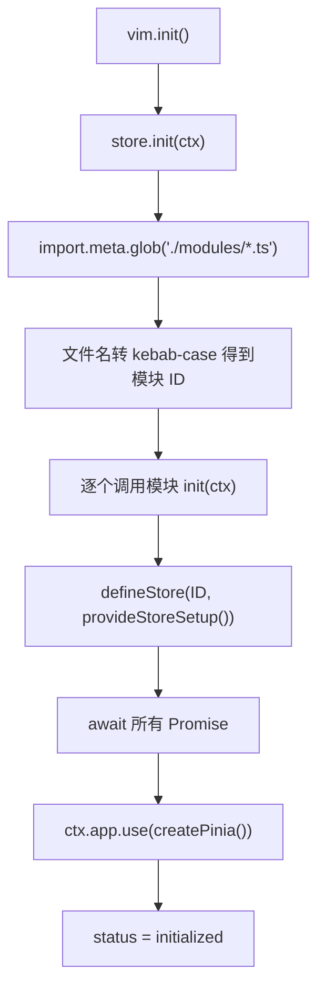

# Familyhelper UI View - 状态管理模块

本文说明 `familyhelper-ui-view` 中 Store 模块的职责、使用方式、扩展约定与生命周期边界，
覆盖 `webapp-pc`、`webapp-mobile` 的 `src/store` 模块。

Store 模块负责全局状态的声明与获取：每个业务状态单元实现为 `src/store/modules/*.ts` 中的一个模块文件，
入口 `src/store/index.ts` 在 VIM 初始化时扫描这些文件，为每个模块生成一个 Pinia StoreDefinition，
再通过 `VimApplicationContext.store()` 暴露 `storeIds`、`vueStoreDefinition`、`vueStore` 三个访问入口。
调用方拿到的是标准 Pinia Store 实例，因此不需要为状态管理再引入另一套读写抽象。

整个模块分为四层职责：

| 层次               | 位置                                                    | 主要职责                                                               |
|--------------------|---------------------------------------------------------|------------------------------------------------------------------------|
| 聚合与状态门禁     | `src/store/index.ts`                                    | 扫描模块、生成 StoreDefinition、维护 `initializing`/`initialized` 状态 |
| 类型契约           | `src/store/types.ts`                                    | `VimStore`、`VimStoreModule`、`SimplyStore`、`StoreSetup`              |
| 业务状态单元       | `src/store/modules/*.ts`                                | 声明 Store 类型，实现状态、动作与模块钩子                              |
| 全局就绪与动作句柄 | `src/util/store.ts`、`component-util/src/util/store.ts` | 聚合各 store 的 `ready`；提供 `ExecutableActionHandle`                 |

## 适用范围

本文适用于以下源码：

- `packages/webapp-pc/src/store`：PC 端 Store 模块。
- `packages/webapp-mobile/src/store`：移动端 Store 模块。
- `packages/component-util/src/util/store.ts`：跨模块协作使用的 `ExecutableActionHandle`。

`packages/webapp-pc/src/util/store.ts` 与 `packages/webapp-mobile/src/util/store.ts` 提供全局 `ready` 计算属性，
与 Store 的“就绪”约定直接相关，也在本文说明范围内。

本文只说明 Store 模块本身的机制与约定，不展开各业务 Store 的字段语义：

- 导航节点、EzNav 与模态配置见 [Familyhelper UI View Navigation](./FamilyhelperUiViewNavigation.md)。
- 登录态、Token 与权限节点字符串的具体规则以 `src/store/modules/lnp.ts` 源码为准。
- Pinia 自身的 `state`、`getter`、`action`、`$patch`、`$subscribe` 用法以 [Pinia 文档](https://pinia.vuejs.org/) 为准，
  本文不重复。

PC 端与移动端当前使用相同的 Store 目录结构，但它们是两个独立应用。
修改其中一端的 `src/store` 不会自动同步到另一端，两端的模块清单也略有差异（见“目录结构”一节）。

## 目录结构

两端的 `src/store` 目录结构相同：

```text
src/store/
├── index.ts    - 模块入口、模块扫描、StoreDefinition 生成与状态门禁
├── types.ts    - VimStore、VimStoreModule、SimplyStore、StoreSetup 等类型
├── README.md   - 模块内使用说明与模块模板
└── modules/    - 按业务划分的 Store 模块
    └── *.ts
```

各文件职责如下：

| 文件           | 主要职责                                                                                |
|----------------|-----------------------------------------------------------------------------------------|
| `index.ts`     | 扫描 `modules/*.ts`，为每个模块调用 `defineStore`，切换初始化状态并导出 `store`         |
| `types.ts`     | 声明 `VimStore`、`SimplyStoreDefinition`、`SimplyStore`、`VimStoreModule`、`StoreSetup` |
| `modules/*.ts` | 默认导出一个 `VimStoreModule`，一个 Store 对应一个文件                                  |

`index.ts` 使用 `import.meta.glob('./modules/*.ts', { eager: true })` 加载模块。
该扫描只包含 `modules` 目录当前这一层的 `.ts` 文件，不包含子目录。

模块 ID 由文件名决定：先把文件路径中的 `./modules/` 前缀和 `.ts` 后缀去掉，再转换为 `kebab-case`。
因此 `pageError.ts` 的模块 ID 是 `page-error`，`lnp.ts` 的模块 ID 是 `lnp`。
调用方传入 `vueStore`、`vueStoreDefinition` 的 `id` 必须是这个转换结果。

PC 端当前的模块文件为 `customize.ts`、`elementPlus.ts`、`iahn.ts`、`lnp.ts`、`navigation.ts`、
`notification.ts`、`pageError.ts`、`theme.ts`、`visualizer.ts`。

移动端当前的模块文件为 `customize.ts`、`iahn.ts`、`lnp.ts`、`navigation.ts`、`pageError.ts`、
`theme.ts`、`visualizer.ts`。

两端的文件列表差异为：PC 端额外提供 `elementPlus.ts` 与 `notification.ts`。
其余同名模块在两端各自维护，属于两个独立应用中的两份实现。

各模块当前提供的内容如下（“就绪”列表示 Store 是否暴露 `ready` 字段）：

| 模块文件          | Store 类型          | 主要内容                                                                | 就绪 |
|-------------------|---------------------|-------------------------------------------------------------------------|------|
| `customize.ts`    | `CustomizeStore`    | 定制项列表、定制覆盖信息的读写与清理                                    | 是   |
| `elementPlus.ts`  | `ElementPlusStore`  | 侧栏菜单显隐、全屏状态                                                  | 否   |
| `iahn.ts`         | `IahnStore`         | 界面语言（locale）列表与切换                                            | 是   |
| `lnp.ts`          | `LnpStore`          | 登录态、Token、权限判定，以及 `willLogin`、`willLogout`、`willFireKick` | 否   |
| `navigation.ts`   | `NavigationStore`   | 导航模态覆盖信息与 EzNav 状态                                           | 是   |
| `notification.ts` | `NotificationStore` | 未读通知计数、`willUpdateUnreadCount` 与轮询更新                        | 否   |
| `pageError.ts`    | `PageErrorStore`    | 全局错误页展示的错误文案                                                | 否   |
| `theme.ts`        | `ThemeStore`        | 当前主题、主题列表与主题值查询                                          | 是   |
| `visualizer.ts`   | `VisualizerStore`   | 当前 Visualizer 实例、Visualizer key 与模态覆盖信息                     | 是   |

初始化时序如下：



几点执行细节：

- `init(ctx)` 的状态必须是 `initializing`，重复初始化会抛出「只能在 initializing 状态下初始化」。
- 模块的 `init(ctx)` 可以返回 `void` 或 `Promise<void>`。返回 Promise 时，StoreDefinition 在该 Promise 完成后才写入；
  其余模块不需要等待它。
- 所有模块的 `init` 与 Promise 都完成后，才调用 `ctx.app.use(createPinia())`，然后才把状态置为 `initialized`。
  因此在 `init` 内部无法取得任何 Store 实例。
- 模块 ID 重复时后者覆盖前者（同一文件名在同一目录下不会重复，实际风险来自两个文件转换成同一 kebab-case 结果）。

## 使用说明

初始化完成后，Store 通过三个入口访问：

| 入口                                                         | 返回                  | 典型用途                   |
|--------------------------------------------------------------|-----------------------|----------------------------|
| `vim.ctx().store().storeIds()`                               | `string[]`            | 枚举当前已注册的模块 ID    |
| `vim.ctx().store().vueStore<'id', XxxStore>('id')`           | Pinia Store 实例      | 常规业务读写               |
| `vim.ctx().store().vueStoreDefinition<'id', XxxStore>('id')` | Pinia StoreDefinition | 需要延迟创建实例的特殊场景 |

三个入口都要求 Store 模块已经进入 `initialized` 状态，否则会抛出 `initializing` 相关错误。

### 获取并使用 Store

业务代码通常只需要 `vueStore`。在组件 `setup` 中、路由守卫中或 VIM 初始化钩子中都可以获取：

```typescript
import vim from '@/vim'

import { type LnpStore } from '@/store/modules/lnp.ts'

function printMe(): void {
  const lnpStore = vim.ctx().store().vueStore<'lnp', LnpStore>('lnp')
  console.log(lnpStore.me)
}
```

`vueStore` 有两个类型参数，二者必须与同一个模块对应：

- 第一个参数是模块 ID 的字面量类型，例如 `'lnp'`，同时决定运行期取哪个 StoreDefinition。
- 第二个参数是该模块导出的 Store 类型，例如 `LnpStore`，只影响类型推导。

源码注释明确要求调用者保证 `id` 与泛型 `SS` 匹配，否则会得到错误的 IDE 补全提示。
实际编码时应保持 `vueStore<'page-error', PageErrorStore>('page-error')` 这种一一对应的写法。

取回的实例与 Pinia Store 完全一致，因此可以直接：

- 读取字段。模块内部以 `ComputedRef` 暴露的字段，在 Store 上被 Pinia 展开为普通 getter，取用时不需要 `.value`。
- 调用动作，例如 `lnpStore.hasPermission('action.eznav.pc.deep_clean')`。
- 使用 `$patch`、`$subscribe`、`$onAction` 等内置方法。

同一个模块 ID 在多次 `vueStore` 调用中返回同一个实例，`storeDefinitions[id]()` 由 Pinia 完成单例管理。
因此不需要在模块之间缓存 Store 实例，也不应该自己再包一层单例。

获取时机需要注意：不要在模块顶层执行 `vim.ctx()`，也不要在模块的 `init(ctx)` 中获取 Store。
这两种位置都发生在 `initialized` 之前。初始化期间的依赖通过 `init(ctx)` 的参数取得，
需要跨 Store 协作时改用下文所述的钩子。

### 获取并使用 StoreDefinition

`vueStoreDefinition` 返回的是 Pinia StoreDefinition 而不是实例，用途是“先拿到定义，稍后再创建实例”。
常见场景包括：

- 需要在明确的时机（而不是取用时就创建）实例化 Store。
- 需要把定义交给其它工具或测试代码，由调用方决定何时调用。

```typescript
import vim from '@/vim'

import { type LnpStore } from '@/store/modules/lnp.ts'

const lnpStoreDefinition = vim.ctx()
  .store()
  .vueStoreDefinition<'lnp', LnpStore>('lnp')

function printMe(): void {
  const lnpStore: LnpStore = lnpStoreDefinition()
  console.log(lnpStore.me)
}
```

调用 StoreDefinition 本身仍要求 Pinia 已经安装到 Vue 应用上，也就是 Store 模块完成初始化之后。
当前两端业务代码中，常规读取都使用 `vueStore`；没有明确需要延迟实例化的理由时，不要为了“看起来更灵活”而改用
`vueStoreDefinition`，否则会多出一层实例化时机判断。

### 注册方法侦听

Store 中的动作往往是跨模块协作的触发点。例如 `lnp` 的登录、登出会同时影响路由、导航和未读通知。
把这些逻辑全部写进 `lnp` 的登录、登出方法会让单一模块承担过多职责，
因此 VIM 使用 Pinia 的 `$onAction` 注册侦听器，让关注方各自注册、各自清理。

`$onAction` 的用法与 Pinia 一致，回调上下文提供 `name`、`args`、`after`、`onError`。
`after` 在动作成功完成后执行，动作失败时进入 `onError`。

以下是 `navigation.ts` 中的真实做法：只在 `lnp` 的 `willLogin` 之后恢复 EzNav 状态。

```typescript
import { type LnpStore } from '@/store/modules/lnp.ts'
import { type SimplyStore } from '@/store/types.ts'

function addEzNavLnpStoreLoginActionListener(): void {
  if (!ctx) {
    throw new Error('不应该执行到此处，请联系开发人员')
  }
  const lnpStore: SimplyStore<'lnp', LnpStore> = ctx.store().vueStore<'lnp', LnpStore>('lnp')
  ezNavLnpStoreLoginActionHandle = lnpStore.$onAction(({ name, after }) => {
    // 只处理登录方法。
    if (name !== 'willLogin') {
      return
    }
    after((result: ExecutableActionHandle<void, void, void>) => {
      result.registerAfterHook(() => restoreAfterLogin(lnpStore))
    })
  })
}
```

注册位置取决于需要访问 Store 的时机：

- 模块级侦听放在 `registerVimInitializedHook` 的回调中。VIM 初始化钩子执行时 Store 已经可用，
  这也是 `navigation.ts`、`notification.ts`、`router/index.ts` 的现有做法。
- 页面级侦听放在组件 `setup` 中。此时 Pinia 会把订阅绑定到组件作用域，组件卸载时自动清理；
  若显式传入 `detached: true`，则失去这个自动清理行为，必须自行调用解除函数。
- 不要在模块的 `init(ctx)` 中注册：此时 `ctx.store().vueStore(...)` 会因状态仍为 `initializing` 而抛错。

模块级注册不属于任何组件作用域，Pinia 不会自动清理，因此 `$onAction` 返回的解除函数必须自行保存。
在不再需要时调用它，否则侦听器会一直累积：

```typescript
// 模块级：保存解除函数，并在窗口卸载钩子中调用。
let lnpStoreLoginActionHandle: () => void = () => {}

ctx.registerWindowBeforeUnloadHook(() => {
  lnpStoreLoginActionHandle()
  lnpStoreLoginActionHandle = () => {}
})
```

在热模块替换环境中，模块级变量会随模块重新执行而丢失，导致旧侦听器无法解除、新侦听器再次注册。
现有模块的处理方式是：声明时先从 `import.meta.hot.data` 还原，注册和解除两处都写回 `import.meta.hot.data`。

侦听器是按 Store 实例累积的，多次注册会叠加执行，不会相互覆盖。
因此需要“全局只执行一次”的逻辑应集中在模块层注册一次，不要在每个组件里各注册一份。

### 注册 ExecutableActionHandle 方法侦听

`$onAction` 只提供“动作完成之后”和“动作出错”两个时机，无法在动作的核心逻辑之前介入。
典型场景是“登出前先保存用户当前的界面状态”：如果只能在登出完成后执行，保存的已经是新状态或已经失效的上下文。

VIM 的解决方式是把这类动作包装成可执行动作句柄：

1. Store 除提供实际动作外，再暴露一个 `willXxx()` 方法，返回 `ExecutableActionHandle`。
2. 调用方通过 `willXxx().execute()` 触发动作，而不是直接调用内部动作。
3. 关注方在 `$onAction` 的 `after` 回调中拿到该句柄，再注册前置钩子或后置钩子。

`lnp` 中的定义如下：

```typescript
import {
  type ExecutableActionHandle,
  ExecutableActionHandleImpl,
} from '@dwarfeng/familyhelper-ui-component-util/src/util/store.ts'

export type LnpStore = {
  // 其它字段略。
  willLogin: (dynamicLoginInfo: LoginInfo) => ExecutableActionHandle<void, void, void>
  willLogout: () => ExecutableActionHandle<void, void, void>
  willFireKick: () => ExecutableActionHandle<void, void, void>
}

function willLogout(): ExecutableActionHandle<void, void, void> {
  return new ExecutableActionHandleImpl(() => logout())
}
```

侦听方在登出前保存数据：

```typescript
const lnpStore = vim.ctx().store().vueStore<'lnp', LnpStore>('lnp')

lnpStore.$onAction(({ name, after }) => {
  if (name !== 'willLogout') {
    return
  }
  after((result: ExecutableActionHandle<void, void, void>) => {
    // 在登出核心逻辑执行之前，保存用户设置。
    result.registerBeforeHook(async () => {
      await saveUserSettings()
    })
  })
})
```

调用方改为执行句柄：

```typescript
function handleButtonClicked(): void {
  lnpStore
    .willLogout()
    .execute()
    .catch(() => {
      console.log('执行失败')
    })
}
```

`ExecutableActionHandle` 的执行顺序与约束如下：

| 项目       | 规则                                                                                      |
|------------|-------------------------------------------------------------------------------------------|
| 执行顺序   | 前置钩子 → 核心逻辑 → 后置钩子                                                            |
| 优先级     | 按 `priority` 数值从小到大分批执行；小 `priority` 整批完成后才开始下一批                  |
| 同批并发   | 同一 `priority` 的钩子在该批次内通过 `Promise.all` 并行执行                               |
| 默认优先级 | `registerBeforeHook(hook)`、`registerAfterHook(hook)` 等价于 `priority = 0`               |
| 注册时机   | 只能在 `execute()` 之前注册；之后注册会抛「不能在 execute 之后添加 beforeHook/afterHook」 |
| 执行次数   | `execute()` 只能调用一次，重复调用会抛「不能重复执行 execute」                            |
| 返回值     | `execute()` 返回所有后置钩子结果的数组，顺序与优先级规则一致                              |

现有代码中的实际用法：

- `navigation.ts` 在 `willLogin` 后注册后置钩子恢复 EzNav；在 `willLogout` 前注册前置钩子，
  取消防抖存储并立即保存 EzNav 数据。
- `router/index.ts` 在 `willLogin`、`willLogout`、`willFireKick` 后注册后置钩子执行路由跳转。
- `notification.ts` 在 `willLogin` 后注册后置钩子刷新未读计数。

使用边界：

- 只有 Store 主动提供 `willXxx()` 时才能使用这套机制。普通动作仍用 `$onAction` 侦听。
- 句柄是一次性的。需要再次执行动作时必须重新调用 `willXxx()`，不要缓存句柄。
- 前置钩子失败会中断核心逻辑，因此前置钩子应只做必要的准备与保存，不要在其中执行可能失败的非关键逻辑。
- 后置钩子接收核心逻辑的返回值，因此适合做“基于结果的后续处理”，例如跳转和状态刷新。

## 特殊字段

Store 中带有框架语义的字段需要额外约定，以便框架工具或其它模块按统一方式消费。
当前只有 `ready` 属于此类字段。

### ready

`ready` 表示“该 Store 是否已经就绪”。它不是一个普通业务字段，而是参与全局就绪判断的标记。

约定如下：

- 需要参与判断的模块在 Store 类型上声明 `ready: ComputedRef<boolean>`，并在 `provideStoreSetup()` 的返回对象中暴露。
- 模块内部通常用 `ref<boolean>(false)` 保存状态、用 `computed` 暴露只读值，并在数据加载完成或失败时统一置为 `true`。
- 未暴露 `ready` 的 Store 不参与判断，例如 `lnp`、`pageError`、`notification`、`elementPlus`。

`src/util/store.ts` 导出一个全局计算属性 `ready`：遍历 `storeIds()`，逐个取得 Store 实例；
若实例上存在 `ready` 属性则参与判断，仅当这些值全部为真时才返回 `true`。
取值时同时兼容 `ComputedRef` 形态（读取其 `value`）与普通布尔值。

视图侧（`views/vim/layout/Layout.vue`、`views/vim/login/Login.vue`、错误页与禁止访问页等）
从 `@/util/store.ts` 引入该 `ready`，在 `ready.value` 为假时渲染遮罩（`VimMask`），为真后才渲染正式内容。
因此一个模块让 `ready` 一直留在 `false`，会直接导致主界面一直停在遮罩状态。

当前暴露 `ready` 的模块在两端的清单一致：`customize`、`iahn`、`navigation`、`theme`、`visualizer`。

实现时应遵守以下习惯：

- `ready` 只在明确的完成点置位。`visualizer.ts`、`navigation.ts` 在加载方法的 `finally` 中调用 `setReady()`，
  保证加载失败也能结束等待；`theme.ts` 在 Visualizer 不支持主题时直接置位。
- 模块之间存在就绪依赖时，用 `watch` 等待上游就绪，而不是在初始化阶段同步读取。
  `theme.ts` 等待 `visualizer` 的 `ready` 与 `visualizerKey` 后再加载主题配置。
- `ready` 可以被重新置回 `false`。`customize.ts` 在开始加载新配置前调用 `resetCustomizeState()`，
  先清空旧状态并复位 `ready`，避免当前 Visualizer 初始化期间仍暴露上一个 Visualizer 的内容。
  因此消费方不应假设 `ready` 一旦为真就永远为真。
- 新增 `ready` 字段会改变全局就绪门槛。若加载流程依赖网络请求，必须确保所有失败分支也能置位。

## 修改说明

修改 Store 模块时，先确认改动落在哪一端。PC 端与移动端是两个独立应用，
同名模块是两份源码，需要同时修改时应分别修改并各自验证。

### 添加模块

Store 模块采用动态扫描机制。在 `src/store/modules` 下新增符合约定的文件后，VIM 会自动加载，
不需要在 `index.ts` 中登记，也不需要修改任何聚合列表。

按以下步骤处理：

1. 确认目标是 PC 端、移动端，还是两端都要增加。两端都需要时，分别新增文件。
2. 在对应应用的 `src/store/modules` 下新增文件，文件必须直接位于该目录下，子目录中的文件不会被扫描。
3. 文件名使用 `camelCase`。模块 ID 由正则从路径中提取文件名再转 `kebab-case`，
   含 `-`、`.` 等非 `\w` 字符的文件名不会被正确提取，模块 ID 会变成异常值。
4. 导出 Store 类型，例如 `export type FoobarStore = { ... }`，便于调用方在泛型中引用。
5. 用 `ref` 保存内部状态，用 `computed` 暴露只读字段，用普通函数实现动作。
6. 实现 `provideStoreSetup(): StoreSetup`，返回 `(): FoobarStore => ({ ... })`。
7. 实现 `init(ctx: VimApplicationContext)`：保存上下文，并按需注册生命周期钩子。
8. 默认导出 `VimStoreModule`，形如 `{ init, provideStoreSetup }`。
9. 在调用方使用 `vueStore<'foo-bar', FoobarStore>('foo-bar')` 获取，模块 ID 与文件名保持一致。
10. 需要参与全局就绪判断时，按“特殊字段”一节的约定提供 `ready`。

一个包含状态、动作、可执行动作句柄和钩子的模块模板如下：

```typescript
// noinspection JSUnusedGlobalSymbols,DuplicatedCode,JSAnnotator

import { type VimApplicationContext } from '@/vim/types.ts'
import { type StoreSetup, type VimStoreModule } from '@/store/types.ts'

import {
  type ExecutableActionHandle,
  ExecutableActionHandleImpl,
} from '@dwarfeng/familyhelper-ui-component-util/src/util/store.ts'

import { computed, type ComputedRef, ref } from 'vue'

// region 初始化逻辑

/**
 * VIM 应用上下文。
 */
let ctx: VimApplicationContext | null = null

function init(_ctx: VimApplicationContext): void {
  ctx = _ctx
  ctx.registerWindowLoadHook(windowLoadHook)
  ctx.registerWindowBeforeUnloadHook(windowUnloadHook)
}

// endregion

// region Store 定义

/**
 * Foobar Store。
 */
export type FoobarStore = {
  ready: ComputedRef<boolean>
  me: ComputedRef<string>
  willLogout: () => ExecutableActionHandle<void, void, void>
}

// Store 区域。
const _ready = ref<boolean>(false)
const _accountId = ref<string>('')

/**
 * 就绪标记。
 */
const ready: ComputedRef<boolean> = computed<boolean>(() => _ready.value)

/**
 * 账号。
 */
const me = computed<string>(() => _accountId.value)

function setReady(): void {
  _ready.value = true
}

function willLogout(): ExecutableActionHandle<void, void, void> {
  return new ExecutableActionHandleImpl(() => logout())
}

async function logout(): Promise<void> {
  _accountId.value = ''
}

/**
 * 提供 Store Setup。
 *
 * @returns Store Setup。
 */
function provideStoreSetup(): StoreSetup {
  // noinspection JSAnnotator
  return (): FoobarStore => ({
    ready,
    me,
    willLogout,
  })
}

// endregion

// region 钩子逻辑

/**
 * Window 加载钩子。
 */
function windowLoadHook(): void {
  loadData()
    .catch(() => {})
    .finally(() => setReady())
}

async function loadData(): Promise<void> {
  // 按需加载数据。
  _accountId.value = ''
}

/**
 * Window 卸载钩子。
 */
function windowUnloadHook(): void {
  // 清除数据。
  _accountId.value = ''
}

// endregion

// region VimStoreModule 定义

/**
 * VIM Store 模块。
 */
const vimStoreModule: VimStoreModule = {
  init,
  provideStoreSetup,
}

// endregion

export default vimStoreModule
```

几个容易遗漏的点：

- `provideStoreSetup` 返回值上的 `// noinspection JSAnnotator` 用于抑制 IDE 对该工厂函数的误报，
  与 `src/store/README.md` 中模板的写法一致。
- Store 类型只声明公开成员。内部 `_xxx` 形式的 `ref` 不进入返回对象，避免调用方直接改写内部状态。
- 动作需要被跨模块在“执行前”介入时，才额外暴露 `willXxx()`；普通动作直接暴露函数即可。
- 两端模块出现差异时，不要用复制粘贴的方式“保持一致”，应确认差异是业务差异还是漂移。

### 生命周期钩子

模块的 `init(ctx)` 只能注册钩子，真正的加载与清理逻辑放在钩子回调中。
三个钩子的注册与执行时机如下：

| 钩子                                               | 注册时机限制                     | 执行时机                                                        |
|----------------------------------------------------|----------------------------------|-----------------------------------------------------------------|
| `ctx.registerVimInitializedHook(hook, order?)`     | 只能在 `initializing` 状态下注册 | 所有模块初始化完成、上下文状态置为 `initialized` 后立即同步执行 |
| `ctx.registerWindowLoadHook(hook, order?)`         | 只能在 `initializing` 状态下注册 | `window` 的 `load` 事件触发时同步执行                           |
| `ctx.registerWindowBeforeUnloadHook(hook, order?)` | 只能在 `initializing` 状态下注册 | `window` 的 `beforeunload` 事件触发时同步执行                   |

`order` 数值越小越先执行，默认值为 `0`；同类钩子在触发时按 `order` 升序排序后依次调用。
三者的限制与排序都在 `src/vim/index.ts` 中实现，非 `initializing` 状态注册会抛出
「只能在 initializing 状态下注册 ... 钩子」。

`order` 的实际用途是控制跨模块的执行顺序。`router/index.ts` 注册 VIM 初始化钩子与 window beforeunload 钩子时
都显式传入 `1000000000`，保证 Store 模块（默认 `0`）先完成各自的初始化与保存清理，然后才注册或移除路由侧的监听器。

各阶段的职责划分如下：

- `init(ctx)`：保存上下文、注册钩子、做不依赖其它 Store 的纯内存初始化。
  此时不能调用 `ctx.store().vueStore(...)`。
- VIM 初始化钩子：此时所有 Store 可用，适合恢复本地持久化数据、注册 `$onAction` 侦听器、
  建立跨 Store 的 `watch`。`customize.ts`、`iahn.ts`、`lnp.ts`、`navigation.ts`、`notification.ts`、
  `pageError.ts`、`theme.ts`、`visualizer.ts` 都使用该时机。
- Window load 钩子：页面资源就绪后开始网络加载与轮询。
  `navigation.ts`、`visualizer.ts` 在此加载模态配置，`lnp.ts` 启动登录状态检查与 10 秒登录保持定时器，
  `notification.ts` 启动未读轮询，`elementPlus.ts` 在此绑定全屏与 F11 监听。
- Window beforeunload 钩子：写回 `localStorage`、清理定时器、调用 `$onAction` 的解除函数。
  `lnp.ts` 在此保存登录参数并清除登录保持定时器，`pageError.ts`、`navigation.ts` 在此保存错误文案与 EzNav 数据，
  `navigation.ts` 还会移除登录、登出侦听器，`notification.ts` 在此清除未读轮询定时器，
  `elementPlus.ts` 在此移除全屏与 F11 监听。

钩子函数当前签名为 `() => void`，返回 Promise 不会被等待，因此：

- 不要在 `beforeunload` 钩子中发起必须完成的异步请求，浏览器不会等待。
  `navigation.ts` 在该钩子处保留了「VIM 的钩子机制必须支持异步操作」的待办说明。
- 需要异步加载的逻辑在 `windowLoadHook` 中以 `.then(...)`/`.catch(...)` 形式自行串联，并把错误转换为通知，
  参考 `navigation.ts`、`visualizer.ts` 中 `loadModal()` 的错误处理写法。

持久化数据的存放位置应沿用现有约定：

- `localStorage` 键使用 `store.persistence_data.<模块>` 或 `store.modal_override_info.<模块>` 前缀，
  例如 `store.persistence_data.lnp`、`store.persistence_data.eznav`、`store.modal_override_info.navigation`。
- 配置仓库分类使用 `framework.pc.<模块>` 或 `framework.mobile.<模块>` 前缀，
  例如 `framework.pc.navigation`、`framework.mobile.theme`。

新增或修改 `localStorage` 结构时，读取侧必须用 `try/catch` 包住 `JSON.parse` 并校验字段，
解析失败时回退到默认值或配置仓库，不要假设本地数据可信。

## 常见问题

### Store 无法获取

Store 相关错误信息通常会指出具体阶段，按以下顺序检查：

1. 错误信息是否为「不能在 initializing 状态下获取 store」「...获取 storeIds」「...获取 storeDefinition」。
   这三种都表示调用发生在 Store 模块初始化完成之前。
2. 调用位置是否在模块顶层、模块的 `init(ctx)` 内部，或 `vim.ctx()` 尚未可用时。
   模块顶层与 `init` 都属于过早，应改到 VIM 初始化钩子、路由守卫或组件 `setup` 中。
3. 错误信息是否为「不能在 initializing 状态下获取 ctx」。这表示 `vim.ctx()` 本身被提前调用，
   与 Store 无关，需要先修正整体初始化时序。
4. `id` 是否与文件名转换结果一致。`pageError.ts` 对应 `page-error`，
   `elementPlus.ts` 对应 `element-plus`；写成 `pageError` 或 `elementPlus` 会取不到定义。
5. 目标模块是否在当前应用中存在。PC 端有 `element-plus`、`notification`，移动端没有这两个模块。
6. 文件是否直接位于 `src/store/modules/*.ts` 且默认导出了 `VimStoreModule`。
   子目录中的文件、缺少默认导出的文件都不会被注册，可用 `vim.ctx().store().storeIds()` 确认实际注册清单。
7. 泛型 `SS` 与 `id` 是否对应。二者不匹配不会改变运行期取到的实例，但会让类型检查与补全指向错误的 Store，
   表现为“字段不存在”或“类型不匹配”这类编译期报错。

若 `id` 拼写错误且该 ID 从未注册，`vueStore` 会在调用 StoreDefinition 时失败，
错误信息是运行期的 `storeDefinitions[id] is not a function` 一类提示，而不是初始化状态错误。

### 方法侦听重复执行

侦听回调执行多次时，按以下方向排查：

1. 侦听器是否在会被多次执行的位置注册。`$onAction` 每次注册都会新增一个监听器，
   同一位置执行两次就会触发两次，不会自动去重。
2. 模块级侦听是否随热模块替换重复注册。模块重新执行后旧监听器仍然存在，
   需要在声明时从 `import.meta.hot.data` 还原解除函数，并在注册、解除两处成对写回。
3. 组件内侦听是否使用了 `detached: true`。未脱离作用域时，Pinia 会在组件卸载时自动清理；
   一旦传入 `detached: true`，就需要自己在 `onUnmounted` 中调用解除函数，否则每次挂载都会累积一个新监听器。
4. 是否同时在模块层与页面层注册了同一段逻辑。同一模块 ID 的 Store 是单例，
   两处注册会同时生效。
5. `ExecutableActionHandle` 是否被重复使用。句柄执行过一次后再次 `execute()` 会抛
   「不能重复执行 execute」；应每次重新调用 `willXxx()` 获取新句柄。
6. 钩子 `order` 变化只影响执行顺序，不会造成重复执行。若同一逻辑既在前置钩子又在后置钩子中注册，
   则会在动作前后各执行一次，这属于注册位置错误而非优先级问题。

定位时可先用 `$onAction` 回调中的 `name` 打印触发来源，确认是监听器数量问题还是动作被调用了多次。

## 参阅

Store 模块与 VIM 其它模块的职责边界、启动链路与协作时序见
[VIM Architecture](./VimArchitecture.md)。

- [Familyhelper UI View](./FamilyhelperUiView.md) - 前端 view 模块（monorepo）导读，
  说明模块定位、包划分与后续文档阅读顺序，细节请参阅该目录内 `README.md`。
- [Familyhelper UI View Development](./FamilyhelperUiViewDevelopment.md) - 前端 view 模块本地开发指南，
  说明环境准备、依赖安装、配置生成、构建、单包开发和代码检查流程。
- [Familyhelper UI View API](./FamilyhelperUiViewApi.md) - API 接口请求模块说明，
  介绍 PC、移动端 API 配置、请求客户端，以及二者与 `component-api` 的协作和修改边界。
- [Familyhelper UI View Navigation](./FamilyhelperUiViewNavigation.md) - 导航模块说明，
  介绍 PC、移动端导航节点、菜单、路由和权限的协作关系、配置位置与扩展约定。
- [VIM Architecture](./VimArchitecture.md) - VIM 总体架构说明，
  梳理 `vim -> api/compreg/library/navigation/router/store/views` 的职责边界、启动链路与协作时序。
